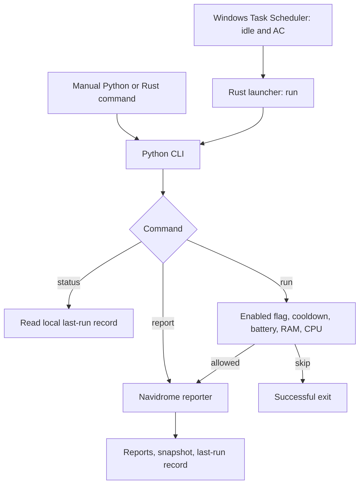

# Nyx architecture

## Scope

Nyx 0.1 has Python Navidrome, Dev, Audio, and Research jobs, an optional dashboard, and one Rust launcher. It preserves the working Navidrome reporter and uses Windows Task Scheduler without adding a resident service. Native Windows 11 on an Intel i3-1115G4 laptop with 16 GB RAM is the target; resource efficiency is a goal, not a measured performance guarantee.

## Persistent product context

The owner's priority order is Navidrome reporting, coding project testing/maintenance, music and FL Studio organization, automated research reports, backups/PC maintenance, then a visual terminal dashboard. `ROADMAP.md` records the milestone sequence and acceptance criteria; `AGENTS.md` records durable decisions and the documentation-update contract.

The existing Navidrome integration targets `https://vxsp.pikapod.net` through private environment configuration. Its first successful report, as supplied by the owner, found **1,736 tracks, 398 albums, 214 artists, and 12 playlists**. This historical aggregate is approved project context, not a fresh server measurement or a fixed test expectation. Detailed reports, paths, playlists, and snapshots remain private.

Accepted boundaries are native Windows without WSL/Docker, Rust for the future background engine and performance-sensitive operations, and Python for integrations, analysis, and reporting. Music operations remain read-only by default. Preserve existing working code and keep resource use low. An initial Python Textual terminal interface is implemented as a saved-state client of the existing CLI; the native background engine remains planned.

## Current boundaries

| Component | Responsibility | Current limit |
| --- | --- | --- |
| `src/main.rs` | Validate command, select Python, start one child, forward exit status | No idle detection or scheduling loop |
| `main.py` | Validated configuration, CLI, admission, locked dispatch, progress/history | No general job registry |
| `nyx/config.py` | Strict known-setting type/range validation and defaults | Unknown future sections preserved |
| `nyx/runtime.py` | OS-managed exclusive job lock, progress and bounded event history | No native idle controller |
| `nyx/logging.py` | Rotating redacted JSON logs | No server bodies/raw exceptions |
| `nyx/saved.py` | Bounded saved-state/report/log reads and cached legacy-snapshot summaries | No network or startup writes |
| `nyx/tui.py`, `nyx/tui.tcss` | Optional Textual views/navigation and explicit manual CLI subprocess | No resident engine or automatic startup scan |
| `jobs/navidrome.py` | HTTPS client, collection, diagnostics, comparison, rendering, writes | Read-only integration |
| `jobs/dev.py` | Configured Git health and opt-in bounded checks | No automatic execution or maintenance in other projects |
| `jobs/audio.py` | Bounded read-only inventory and optional tag diagnostics | No FLP reference parser, content hashing, or cleanup |
| `jobs/research.py` | Configured RSS/Atom/public-release fetches and private digests | Explicit manual invocation; no unattended monitor |
| `config/settings.json` | Versioned resource and collection defaults | Known fields validated before work |
| `config/.env` | Private server/login/output settings | Local only |
| `scripts/*.ps1` | Setup, manual invocation, opt-in task registration | Registration modifies Windows state |
| `tests/` | Offline behavior checks | No real server or Task Scheduler integration |

Core Python has three direct dependencies: `requests`, `python-dotenv`, and `psutil`. Versions use bounded ranges, not a lock. Optional `requirements-tui.txt` pins Textual 8.2.8 and `requirements-audio.txt` pins Mutagen 1.48.1; both imports/dependencies stay out of scheduled reporting. Rust uses only the standard library. Existing paths remain in place to preserve scripts and imports.

## Execution flow

The launcher requires the project root as its working directory, closes child stdin, waits, and returns success or a bounded failure code. It is not a daemon. Task Scheduler controls idle admission and interruption.

`run` checks the enabled flag, successful-run cooldown, then resources while holding the job lock. CPU sampling waits 0.8 seconds. Checks occur once, not continuously. `report` bypasses these gates but holds the same lock and updates the successful-run timestamp. `status` reads local state without HTTP or loading settings. Malformed/naive cooldown records are treated as due.

The OS file lock in `state/job.lock` serializes Python Navidrome/Dev report processes and releases on process exit; the lock file stays on disk. Manual contention returns code 2; a scheduled contention is a successful skip. JSONL event history retains at most 500 entries; `current-job.json` records progress. A crash can leave a last-recorded running event; it is not proof a process is still active.

The registration script uses an interactive-token account, least privilege, idle/AC conditions, stop/restart on idle changes, no waking, and a 15-minute execution limit. Ignore-new prevents overlapping scheduled instances only. Its create-or-update call can replace a task named `Nyx`; inspect it and obtain approval before replacement.

## Navidrome data flow

1. The runner loads `config/.env` and `config/settings.json`; existing process environment values take precedence.
2. `NavidromeClient` requires HTTPS and nonempty login fields.
3. Each HTTP GET uses Subsonic token-and-salt authentication. The protocol's MD5 construction is for API compatibility, not password storage. Network errors omit authenticated request URLs.
4. Collection calls `ping`, `getScanStatus`, `getArtists`, and `getPlaylists`.
5. `getAlbumList2` pages through albums; sequential `getAlbum` requests fetch their tracks. Repeated album IDs are fetched once, repeated song IDs are counted once, and missing IDs abort rather than save an incomplete snapshot. Reaching the album safety limit also aborts.
6. Pure summary/render functions compare metadata with the previous snapshot and produce Markdown. Progress callbacks expose phase/counts without titles or authenticated URLs.
7. The reporter replaces the dated report, `Navidrome report - latest.md`, the saved aggregate summary, then the library snapshot.
8. The runner writes `last-run.json` only after the reporter returns successfully.

The client is internally generic, but the current reporting flow calls only read endpoints. It never starts scans, edits playlists, downloads audio, or changes tags.

## Persistence and privacy

| Path | Data | Git policy |
| --- | --- | --- |
| `config/.env.example` | Placeholder hostname and empty login fields | Tracked |
| `config/.env` | Private settings | Ignored |
| `config/settings.json` | Nonsecret defaults | Tracked |
| `reports/Navidrome/*.md` | Latest and dated reports | Ignored |
| `state/navidrome-last.json` | Previous successful library metadata | Ignored |
| `state/last-run.json` | Success time, status, module, local report path | Ignored |
| `logs/nyx.log` | Redacted JSON events; 256 KiB rotation with two backups | Ignored |
| `state/navidrome-summary.json` | Compact latest statistics/diagnostics | Ignored |
| `state/history.jsonl` | Last 500 execution events | Ignored |
| `state/current-job.json` | Last recorded job phase/status | Ignored |
| `state/job.lock` | OS-managed report/run exclusion | Ignored |

An optional `NYX_REPORT_DIR` moves report output, not state. Filenames use the host's local date; timestamps use UTC. Same-day runs replace the dated report.

The implemented names are `Navidrome/Navidrome report - YYYY-MM-DD.md` and `Navidrome/Navidrome report - latest.md`, matching the owner's prefix and separator. Legacy date-only/`Latest.md` files are left untouched. JSON snapshots continue; returned paths and last-run records use the new dated name.

`atomic_write` creates a unique sibling temporary file, closes it before `os.replace` for Windows compatibility, and cleans up its own temporary file on ordinary failure. This protects individual replacement, not a multi-file transaction. Report/summary files can advance before a later write fails; abrupt process termination can leave a temporary file. Only one previous library snapshot is retained.

Snapshots can contain library paths, artists, titles, and playlist metadata. Treat them and reports as private even without credentials. Do not publish starter archives or use real snapshots as fixtures.

## Known gaps

- Rust is a launcher, not the planned controller. Native idle detection, priorities, and modular scheduling/cancellation are absent. The initial Python TUI is implemented.
- Rust compilation and Task Scheduler behavior were not verified during repository preparation because the Rust toolchain was unavailable.
- Collection checks a deadline before/after every API call, including initial calls/pagination, and caps connect/read timeouts to the remaining budget. This is cooperative; socket activity/read-timeout semantics and cancellation still require native lifecycle enforcement.
- Known settings are type/range validated. The client validates its response envelope, HTTPS URL, and read-endpoint allowlist; some nested malformed library payloads still need stricter checks. Untrusted server error messages are not echoed.
- Library metadata stays in memory. No streaming aggregation or memory cap exists.
- The Python job lock prevents concurrent report/run writers; output writes are still not one transaction.
- A personal-server fallback remains in `run_report` to preserve starter behavior. New installations must explicitly configure their server.
- Python dependencies are not locked. Rust has no unit tests. Offline tests cover a subset of failure modes.
- The installer now stops on venv/pip failure. Task registration can still overwrite an existing task; no unattended behavior was activated.

## Planned responsibilities

Future Rust work should own lightweight scheduling, Windows state observation, lifecycle/cancellation, and performance-sensitive coordination. Python should own network integrations, analysis, research, and reports. Keep jobs independently callable and testable; agree on configuration, results, and failure contracts before introducing a persistent controller.

The TUI exposes saved overview/statistics, formats/diagnostics, job state/history/output, reports, and errors across five keyboard-accessible tabs. Saved summaries are preferred; legacy snapshots are summarized locally and cached by file signature. Malformed/missing state becomes unavailable data. Navidrome/Dev reports are limited to the configured output tree and 512 KiB previews; links do not open automatically.

Opening or refreshing the dashboard never starts collection. N explicitly launches the Python `report` command as a hidden Windows subprocess with streamed output. A UI guard and engine OS lock prevent duplicate work. X stops only a process owned by that dashboard; Q waits for completion or explicit cancellation. Other scheduled/background processes are not owned or cancelled by the UI. Events after forced termination can be stale and are labeled as last-recorded state. No additional service is installed.

An initial Nyx Dev health reporter is implemented; automatic maintenance is not. Read-only Audio inventory and optional tag diagnostics are implemented; FLP reference/unused-sample analysis, backups, system maintenance, and historical analytics remain planned. Research has an initial explicitly invoked digest implementation. Validate the current Windows execution lifecycle before expanding jobs. Future file mutation or cleanup requires an explicit safety design and approval for destructive operations.

## Validation and documentation maintenance

There are 62 passing offline Python tests, including configuration failures, Windows OS locking, atomic writes, naming, redaction, budgets, pagination/deduplication, historical-secret detection, headless TUI navigation, and real Windows synthetic child execution/cancellation. UI startup/refresh tests forbid network/process launches. Dependency consistency passes. PowerShell syntax validation does not establish installation or scheduling behavior. Rust/native idle lifecycle validation remains pending; see `docs/WINDOWS_VALIDATION.md`. No fresh live report was run for these changes.

Public repository: `https://github.com/vxsp/nyx`, branch `main`, remote `origin`. Initial publication was verified by comparing all 26 remote file paths/blob hashes with the published local tree. Every push requires a redacted candidate/history audit.

Keep this description aligned with source changes, update milestone state in `ROADMAP.md`, and carry durable decisions into `AGENTS.md` in the same change. Recheck implementation before promoting any planned capability to completed. Unrelated ChatGPT conversations need repository access or these documents supplied explicitly to recover the context.

## Nyx Dev boundary

`dev-report` reads repositories configured in private `config/projects.local.json` (or the `dev.repositories` settings section). The safe example is versioned; no directories outside the configured roots are discovered. Git inspection disables optional index writes and fsmonitor commands, never fetches, and reports access/trust/unborn-history issues instead of changing repository configuration.

Declared checks run only with `--run-checks`. Commands are argument arrays, never inferred shell strings; relative executable paths resolve against the target repository. Direct .bat/.cmd runners are rejected. Per-check timeouts are 1-3600 seconds, bounded by a shared 600-second report budget. Output is disk-backed with a 1 MiB stop threshold checked every 50 ms and a redacted 16 KiB saved tail. This is cooperative, not a hard disk quota. Windows timeout handling targets only the launched PID/tree; a check that daemonizes after its parent exits is not securely contained. Use trusted commands; native process containment belongs to milestone D before unattended use.

Dependency checks are explicitly declared commands. Pip-style JSON can yield an outdated-package count; missing/truncated/unrecognized output is not treated as a measured count. Nyx never installs or upgrades those dependencies automatically.

Reports live under `reports/Dev/`; private details go to `state/dev-last.json`, successful report paths to `dev-last-run.json`, and module-tagged events to the shared bounded history. Dev reports do not change Navidrome's cooldown. A successful report job means the report was generated, not that every project check passed; individual findings retain their own status.

## Nyx Audio boundary

`audio-report` reads only roots declared in private `config/audio.local.json` (or `audio` settings). Traversal is bounded by visited entries and a cooperative deadline; links/reparse points and common generated/system folders are skipped. Overlapping roots do not double count selected files. Access failures and exhausted budgets make the scope explicitly partial.

Inventory uses directory metadata only, reporting formats, FLP presence, repeated-whitespace naming flags, same-name/size duplicate candidates, and large lossless/export candidates. It does not prove content identity or file usage. Optional `--read-tags` uses Mutagen with read-only binary handles; unsupported/corrupt files are unavailable, never counted as missing tags. Parser I/O is not a hard deadline. Reports/JSON stay private under `reports/Audio/` and `state/audio-last.json`; the dashboard browser includes them.

No files are moved, renamed, retagged, hashed, or deleted. FLP internals/sample references are not parsed, so unused-file findings remain unavailable. Synthetic WAV tests verify bytes are unchanged after the real parser runs. No personal music directory was scanned for development.

## Nyx Research boundary

`research-report` uses only private `research.local.json` or configured `research` settings: at most 20 HTTPS feeds/public GitHub repositories, 1 MiB per response, 50 RSS/Atom entries or 10 stable releases per source, and a cooperative 1-600-second budget. UTF-8 XML rejects DTD/entity declarations before parsing. Redirects and implicit .netrc authentication are disabled; configure final HTTPS source URLs. Request/cache headers never contain GitHub credentials. ETag/Last-Modified reduce repeated transfers.

Article identity hashes canonical URLs (without fragments/UTM tracking) or stable source IDs. Retain at most 5,000 seen IDs and 1,000 reading metadata records. Digests display up to 200 retained items collected that local day, preserving earlier same-day entries across refreshes/failures; source status and newly collected count stay explicit. Failed sources retain previous history/cache; errors expose types only. Publisher dates remain source-provided, not invented UTC measurements.

`research-read --item-id PREFIX` explicitly marks a unique known entry read under the shared job lock. Fetched/seen does not mean read. Markdown fields are escaped and report links are encoded. Reports appear under `reports/Research/`; private state is `state/research-last.json`. No periodic monitoring is enabled until scheduling is implemented and verified. Tests use synthetic responses, never live research sources.
