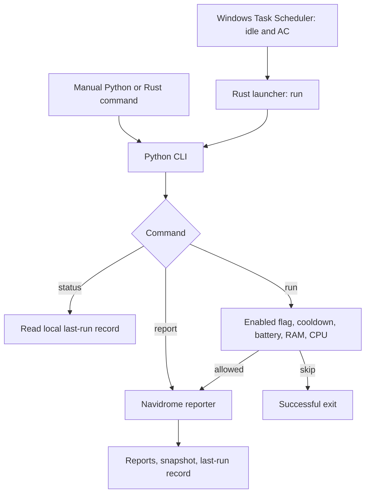

# Nyx architecture

## Scope

Nyx 0.1 has one Python job and one Rust executable. It preserves the working Navidrome reporter and uses Windows Task Scheduler without adding a resident service. Native Windows 11 on an Intel i3-1115G4 laptop with 16 GB RAM is the target; resource efficiency is a goal, not a measured performance guarantee.

## Current boundaries

| Component | Responsibility | Current limit |
| --- | --- | --- |
| `src/main.rs` | Validate command, select Python, start one child, forward exit status | No idle detection or scheduling loop |
| `main.py` | Configuration, CLI, scheduled-run gates, dispatch, last-run record | No general job registry |
| `jobs/navidrome.py` | HTTPS client, collection, diagnostics, comparison, rendering, writes | Only implemented job |
| `config/settings.json` | Versioned resource and collection defaults | No schema validation |
| `config/.env` | Private server/login/output settings | Local only |
| `scripts/*.ps1` | Setup, manual invocation, opt-in task registration | Registration modifies Windows state |
| `tests/` | Offline behavior checks | No real server or Task Scheduler integration |

Python has three direct dependencies: `requests`, `python-dotenv`, and `psutil`. Versions use bounded ranges, not a lock. Rust uses only the standard library. Existing paths remain in place to preserve scripts and imports.

## Execution flow

The launcher requires the project root as its working directory, closes child stdin, waits, and returns success or a bounded failure code. It is not a daemon. Task Scheduler controls idle admission and interruption.

`run` checks the enabled flag, successful-run cooldown, then resources. CPU sampling waits 0.8 seconds. Checks occur once, not continuously. `report` bypasses all three gates but updates the same successful-run timestamp. `status` reads local state without HTTP.

The registration script uses an interactive-token account, least privilege, idle/AC conditions, stop/restart on idle changes, no waking, and a 15-minute execution limit. Ignore-new prevents overlapping scheduled instances only. Its create-or-update call can replace a task named `Nyx`; inspect it and obtain approval before replacement.

## Navidrome data flow

1. The runner loads `config/.env` and `config/settings.json`; existing process environment values take precedence.
2. `NavidromeClient` requires HTTPS and nonempty login fields.
3. Each HTTP GET uses Subsonic token-and-salt authentication. The protocol's MD5 construction is for API compatibility, not password storage. Network errors omit authenticated request URLs.
4. Collection calls `ping`, `getScanStatus`, `getArtists`, and `getPlaylists`.
5. `getAlbumList2` pages through albums; sequential `getAlbum` requests fetch their tracks. Reaching the album safety limit aborts instead of saving a deliberately truncated snapshot.
6. Pure summary/render functions compare metadata with the previous snapshot and produce Markdown.
7. The reporter replaces the dated report, then `Latest.md`, then the library snapshot.
8. The runner writes `last-run.json` only after the reporter returns successfully.

The client is internally generic, but the current reporting flow calls only read endpoints. It never starts scans, edits playlists, downloads audio, or changes tags.

## Persistence and privacy

| Path | Data | Git policy |
| --- | --- | --- |
| `config/.env.example` | Placeholder hostname and empty login fields | Tracked |
| `config/.env` | Private settings | Ignored |
| `config/settings.json` | Nonsecret defaults | Tracked |
| `reports/Navidrome/*.md` | Latest and dated reports | Ignored |
| `state/navidrome-last.json` | Previous successful library metadata | Ignored |
| `state/last-run.json` | Success time, status, module, local report path | Ignored |
| `logs/` | Reserved output directory; no logging subsystem yet | Contents ignored |

An optional `NYX_REPORT_DIR` moves report output, not state. Filenames use the host's local date; timestamps use UTC. Same-day runs replace the dated report.

`atomic_write` writes a sibling `.tmp` file and uses `os.replace`. This protects one file replacement, not a multi-file transaction. Report files can advance before a later write fails. Fixed temporary names create concurrent-writer risks; cancellation can leave temporary files. Only one previous snapshot is retained.

Snapshots can contain library paths, artists, titles, and playlist metadata. Treat them and reports as private even without credentials. Do not publish starter archives or use real snapshots as fixtures.

## Known gaps

- Rust is a launcher, not the planned controller. Native idle detection, priorities, modular scheduling/cancellation, and the TUI are absent.
- Rust compilation and Task Scheduler behavior were not verified during repository preparation because the Rust toolchain was unavailable.
- The time-budget check covers per-album retrieval, not initial calls or album pagination; an in-flight request can overrun it.
- Configuration has no schema checks. Invalid types/ranges, malformed API response shapes, and some malformed state can raise errors. Settings load before the runner's reporting exception handler.
- Cooldown parsing tolerates missing/invalid JSON and some missing fields, but not every data shape or naive timestamp.
- Library metadata stays in memory. No streaming aggregation or memory cap exists.
- Manual and scheduled invocations have no application-wide lock. Output writes are not one transaction.
- A personal-server fallback remains in `run_report` to preserve starter behavior. New installations must explicitly configure their server.
- Python dependencies are not locked. Rust has no unit tests. Offline tests cover a subset of failure modes.
- The installer does not explicitly propagate every native-command failure; confirm pip succeeded. Task registration can overwrite an existing task.

## Planned responsibilities

Future Rust work should own lightweight scheduling, Windows state observation, lifecycle/cancellation, and performance-sensitive coordination. Python should own network integrations, analysis, research, and reports. Keep jobs independently callable and testable; agree on configuration, results, and failure contracts before introducing a persistent controller.

Repository maintenance, local music/FL Studio analysis, research, backups, system maintenance, historical analytics, and a TUI are plans, not implemented modules. Validate the current Windows execution lifecycle before expanding jobs. Future file mutation or cleanup requires an explicit safety design and approval for destructive operations.
