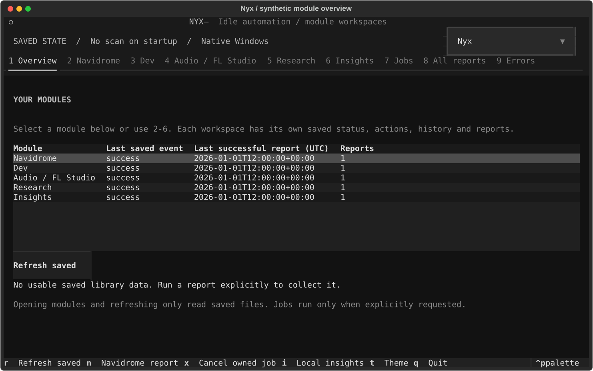

# Nyx

Nyx is a personal Windows 11 automation project built with Rust and Python. It targets an Intel i3-1115G4 laptop with 16 GB RAM, prioritizing low resource use, read-only integrations, and maintainable modules.

Version 0.1 implements a Navidrome library reporter, an optional Textual dashboard, and a one-shot Rust launcher. Windows Task Scheduler supplies idle scheduling. The existing reporter has generated a real report successfully; its credentials, reports, and library snapshots stay outside Git.

## Development status

| Capability | Status |
| --- | --- |
| Read-only Navidrome/Subsonic collection over HTTPS | Implemented |
| Library counts, formats, indexed sizes, metadata diagnostics | Implemented |
| Possible duplicates and changes since the previous snapshot | Implemented; metadata heuristics and track IDs only |
| Dated/latest Markdown reports and local JSON state | Implemented |
| Scheduled-run cooldown and battery/CPU/RAM prechecks | Implemented |
| Rust launcher forwarding one command to Python | Implemented; compilation unverified during preparation |
| PowerShell setup and idle-task registration | Scripts present; registration unverified during preparation |
| Native Rust idle detection, modular scheduling, cancellation | Planned |
| Configured project health, test/build/dependency checks | Implemented initial Nyx Dev; commands require explicit opt-in |
| Read-only music/FL Studio inventory and optional tag diagnostics | Implemented initial Nyx Audio; FLP sample usage unavailable |
| Configured RSS/Atom and public release digests, seen/read history | Implemented initial Nyx Research; manual only |
| Automatic repository maintenance and FLP reference/unused-file analysis | Planned |
| Interactive Textual dashboard reading saved state | Implemented initial version; headless Windows tests passed |
| Local historical Insights and controller measurements | Implemented initial version; missing history stays unavailable |
| Backups and PC maintenance | Scrapped by the owner; no module installed |

Nyx accesses an existing Navidrome server; it does not install or host one. Current comparison uses the last complete snapshot, not a historical analytics database.

Persistent project context lives in [AGENTS.md](AGENTS.md), [ARCHITECTURE.md](ARCHITECTURE.md), and [ROADMAP.md](ROADMAP.md). The roadmap records the owner's priorities, first-report baseline, and accepted implemented `Navidrome report` filename prefix.

## Windows setup

Use native Windows 11 and PowerShell. WSL, Docker, and additional background services are not required.

Prerequisites:

- Python 3.10 or newer with the Windows `py` launcher. The local preparation environment uses Python 3.14.6.
- Git for source control.
- Optional: stable Rust with the Windows MSVC toolchain and Visual Studio C++ Build Tools.
- An existing HTTPS Navidrome server and a library-reading account. Prefer only the permissions needed for reporting.

Open PowerShell in the project root:

```powershell
.\scripts\install-dependencies.ps1
```

This creates `.venv`, installs the three direct dependencies in `requirements.txt`, and copies `config/.env.example` to `config/.env` only if the private file does not exist. Confirm pip succeeded. If PowerShell policy blocks scripts, follow your machine's policy or use the individual commands below; no permanent policy change is required.

```powershell
py -3 -m venv .venv
.\.venv\Scripts\python.exe -m pip install -r requirements.txt
# Run only when config\.env does not already exist:
Copy-Item config\.env.example config\.env
```

Edit the private `config/.env`:

| Variable | Purpose |
| --- | --- |
| `NAVIDROME_URL` | Your HTTPS server; replace the example hostname |
| `NAVIDROME_USERNAME` | Your private username |
| `NAVIDROME_PASSWORD` | Your private password |
| `NYX_REPORT_DIR` | Optional report directory; defaults to the project's `reports/` |

Process environment variables take precedence over `.env`. Set the URL explicitly: a personal-server fallback remains in `jobs/navidrome.py` to preserve starter behavior. New installs should use their own URL.

## Commands

Run from the project root:

```powershell
.\.venv\Scripts\python.exe main.py status
.\.venv\Scripts\python.exe main.py report
.\.venv\Scripts\python.exe main.py run
```

- `status` reads the last successful run record without contacting Navidrome.
- `report` runs manually, bypassing the enabled flag, cooldown, and resource prechecks. It holds an OS job lock, contacts Navidrome, and writes local reports/state.
- `run` respects the enabled flag, cooldown, and resource prechecks. Skipped runs exit successfully.
- `scripts/manual-report.ps1` invokes the same manual `report` command.

Successful runs write `reports/Navidrome/Navidrome report - YYYY-MM-DD.md`, `Navidrome report - latest.md`, `state/navidrome-last.json`, `state/navidrome-summary.json`, and `state/last-run.json`. Legacy reports are preserved. The report directory override does not move state. Same-day runs replace that day's report. Filenames use local dates; snapshot timestamps use UTC.

Shared defaults in `config/settings.json`:

| Setting | Default |
| --- | ---: |
| Minimum hours between scheduled reports | 24 |
| Minimum available RAM | 3 GiB |
| Maximum CPU usage at precheck | 35% |
| Require AC when battery information is available | true |
| Album page size / maximum albums | 200 / 2000 |
| HTTP read timeout | 12 seconds |
| Album retrieval budget | 600 seconds |

Resource checks occur once; they do not throttle an active job. All API calls and pagination share a cooperative deadline with bounded request timeouts; this is not a hard process execution limit. Invalid known configuration fields fail before requests are sent.

## Nyx Dev project health

Keep repository paths and check commands private. Copy `config/projects.example.json` to ignored `config/projects.local.json`, replace the placeholder root with an explicitly selected repository, and review its command arrays.

Dev currently checks local folders only. An inventory of GitHub-owned repositories does not create local checkouts or enable their tests. GitHub-only projects need a separately authorized checkout before local inspection/testing; standalone folders without Git will report that Git metadata is unavailable. Leave `checks` empty until trusted commands are deliberately chosen.

```powershell
# Read Git metadata only; declared project commands are not executed:
.\.venv\Scripts\python.exe main.py dev-report
# Explicitly run the configured tests/build/dependency checks:
.\.venv\Scripts\python.exe main.py dev-report --run-checks
```

No configured repositories means an actionable empty report, not a scan of your drive. Nyx never automatically fetches, installs, upgrades, commits, pushes, resets, or cleans other projects. Opted-in commands execute project code and can have their own side effects. Use trusted executable runners, not direct .bat/.cmd scripts.

Results include branch/dirty state, per-check status, bounded output, and pip-style outdated-package counts when a declared dependency check returns valid JSON. Reports stay under `reports/Dev/` and appear in the dashboard browser; private JSON details are in `state/dev-last.json`. Navidrome cooldown is unaffected. A successfully generated report can contain failed checks.

Checks have individual timeouts within a 600-second total budget. Capture stops near 1 MiB (sampled every 50 ms), saving only a redacted 16 KiB tail. Windows checks run inside an owned Job Object from process creation. Remaining workers stop when the check completes, times out, exceeds output limits, or its Nyx runner terminates. A containment failure prevents the check from starting. Checks that intentionally leave background workers running will have those workers stopped. This controls process lifetime; commands still need to be trusted. Unattended Dev execution remains disabled pending the native controller.

## Nyx Audio inventory

Copy `config/audio.example.json` to ignored `config/audio.local.json` and explicitly select music/FL Studio roots.

```powershell
# Directory metadata only:
.\.venv\Scripts\python.exe main.py audio-report
# Optional read-only tag parsing:
.\.venv\Scripts\python.exe -m pip install -r requirements-audio.txt
.\.venv\Scripts\python.exe main.py audio-report --read-tags
```

The scanner skips links/reparse points, limits entries/time, reports partial scope, and leaves originals unchanged. Reports show formats, FLP counts, naming flags, same-name/size duplicate candidates, and large lossless/export candidates. Optional tags use read-only file handles; unavailable parsing is not treated as missing metadata.

FLP internals/sample usage and confirmed content identity are **not** established. Nothing is marked safe to delete. Reports and inventory JSON stay private; the dashboard browser includes Audio reports.

## Nyx Research digests

Copy `config/research.example.json` to ignored `config/research.local.json` and replace placeholder feeds/repositories. Use final HTTPS feed URLs; redirects and implicit .netrc authentication are disabled.

```powershell
.\.venv\Scripts\python.exe main.py research-report
# Explicitly acknowledge a known article ID shown in the digest:
.\.venv\Scripts\python.exe main.py research-read --item-id 0123456789ab
```

The ID above is a placeholder. Collection fetches bounded RSS/Atom entries and stable public GitHub releases, deduplicates articles, and records source status/date information. Digests remain cumulative within the local day (up to 200 displayed); refreshes do not discard earlier same-day entries. State retains 5,000 seen IDs and 1,000 reading records. Seen is not treated as read.

For larger follow lists, `github_repositories` contains fixed repositories checked on every run, while `github_repository_pool` accepts up to 2,000 repository names to rotate through. `github_batch_size` must fit alongside the feeds/fixed repositories within the unchanged **20-source limit per run**. Duplicate repository names are removed case-insensitively. The saved cursor advances only for attempted pool sources; a changed pool resets it. Budget exhaustion or HTTP 403/429 defers the remaining sources. Reports and the module summary show pool/batch coverage; following a pool does not mean every repository was checked in one run.

Imported GitHub stars/watches are a private snapshot, not continuous account synchronization. Refresh the local import to add newly starred/watched repositories. Research uses public release endpoints without stored GitHub credentials; private repositories are excluded. This tracks releases, not every commit/issue or arbitrary web research. RSS source URLs should be verified against the bounded parser before use; a valid website URL alone is not a feed.

Reports stay private under `reports/Research/` and appear in the browser. Source failures preserve retained history; unavailable dates are labeled. No source means an actionable empty report, not automatic web research. Periodic monitoring is not enabled.

## Local historical Insights

```powershell
.\.venv\Scripts\python.exe main.py insights-report
```

This reads saved library data, completed-job events, and measured history only. The dashboard's sixth tab shows the report; I generates it explicitly. Missing history stays unavailable. Library growth requires two comparable successful observations for the same server/account/metric definition.

New report jobs record bounded duration, Python-controller CPU seconds/RSS, outcome, and real saved counts. These measurements exclude external test/build child CPU and are not system-wide or peak usage. Telemetry errors do not break working reports. Success rates describe recorded report completion, not a guarantee that every project check passed.

Backups/PC maintenance were scrapped in the owner's roadmap. No backup module or portable tool is retained; backup history is unavailable.

## Interactive dashboard

Install the optional interface and open it from the project root:

```powershell
.\.venv\Scripts\python.exe -m pip install -r requirements-tui.txt
.\.venv\Scripts\python.exe main.py tui
```

The dashboard opens on a module overview. **Navidrome**, **Dev**, **Audio / FL Studio**, **Research**, and **Insights** each have a dedicated workspace with their own saved status, summary, action, history, report list, and preview. Navidrome statistics/formats/diagnostics live inside its workspace. Shared Jobs, All reports, and Errors pages remain available. Opening or switching pages reads saved data only; a new scan is not required. Original snapshot/report names are supported. No extra service is installed.

Module buttons explicitly launch the existing CLI: Dev inspects Git metadata without executing checks; Audio inventories configured folders without reading tags; Research fetches only configured sources; Insights reads local history. Each page explains its private setup file and limits. Tests/builds (`dev-report --run-checks`), tag reading (`audio-report --read-tags`), and research read acknowledgements remain explicit CLI actions. One shared job lock prevents modules from running reports concurrently.

Choose **Nyx**, **Catppuccin Mocha**, or **AMOLED Black** in the theme selector at the top, or press **T** to cycle. AMOLED uses pure black for the main background, panels, and cards. Your selection is saved locally in ignored `state/tui-preferences.json` and restored next time. Opening/refreshing the dashboard does not write preferences; unavailable/corrupt preferences fall back to Nyx. If saving fails, the selected theme still works for the current session. No additional dependency is needed.

| Key | Action |
| --- | --- |
| 1 | All-module overview; select a row and press Enter to open a module |
| 2-6 | Navidrome, Dev, Audio / FL Studio, Research, Insights |
| 7-9 | Shared Jobs, All reports, Errors |
| R | Reload saved files only |
| T | Cycle Nyx, Catppuccin Mocha, AMOLED Black; remember the selection locally |
| I | Explicitly generate local Insights from saved state; no network |
| N | Explicit Navidrome report from any page (bypasses admission checks; holds job lock) |
| X | Cancel only the dashboard-owned manual process |
| Q | Quit; guarded while an owned report runs |
| Tab / arrows / Enter | Navigate controls and select reports |

Manual job output streams into the Jobs tab. Existing scheduled jobs are independent; the dashboard cannot cancel them. Saved running state may be stale after a crash. The report browser includes legacy files and disables automatic link opening. One owner-approved manual live CLI report passed on 2026-11-05; fresh-machine terminal appearance and dashboard-triggered live child integration remain separate checks.



Core scheduled reporting does not require Textual. Dashboard tests skip if the optional dependency is absent.

## Optional Rust launcher and idle task

Check the native compiler prerequisites with `./scripts/setup-rust.ps1`. If missing, use `./scripts/setup-rust.ps1 -InstallBuildTools` in an Administrator PowerShell, then `./scripts/setup-rust.ps1 -InstallRust` in your normal user PowerShell. Installation is explicit; default mode only reads system state. The install paths are prepared but have not been exercised locally because administrator elevation is unavailable. See [Windows validation](docs/WINDOWS_VALIDATION.md) before building or enabling scheduling.

```powershell
cargo build --release
.\target\release\nyx.exe status
```

The launcher accepts `run`, `report`, or `status`, defaulting to `run`. Its working directory must be the project root. It prefers `.venv\Scripts\python.exe`, falling back to `python` on PATH. It exits when its Python child finishes.

After a manual report succeeds, inspect any existing task named `Nyx` before registration:

```powershell
.\scripts\register-idle-task.ps1
```

The existing script creates **or replaces** that task. Obtain the owner's approval before replacing an existing task. Registration is an explicit setup step, never part of tests. The task uses the current interactive account and least privilege, requires idle/AC conditions, stops on activity or battery power, ignores overlapping scheduled instances, and has a 15-minute limit. It does not wake the PC. Windows determines idle timing; no exact idle duration is promised. Inspect the task in `taskschd.msc`.

## Development checks

```powershell
.\.venv\Scripts\python.exe -m unittest discover -s tests -v
.\.venv\Scripts\python.exe -m pip check
cargo test
```

Python tests use synthetic data, mocks, and temporary directories without live credentials or server requests. Rust has no unit tests yet; `cargo test` checks compilation when a toolchain is available. See [CONTRIBUTING.md](CONTRIBUTING.md).

## Layout

```text
nyx/
  main.py                   Python CLI, resource gates, status
  jobs/
    __init__.py
    navidrome.py            API, collection, analysis, reports
    dev.py                  Configured project health and opt-in checks
    audio.py                Read-only inventory and opt-in tag diagnostics
    research.py             Explicit configured digests/read acknowledgements
    insights.py             Local historical analysis
  src/main.rs               One-shot Rust launcher
  Cargo.toml                Rust manifest; no external dependencies
  requirements.txt          Core Python dependency ranges
  requirements-tui.txt      Optional pinned Textual dependency
  nyx/
    modules.py              Fixed dashboard module identities and commands
    module_views.py         Scoped module workspaces
    tui.py, tui.tcss         Shared navigation, execution and styles
    themes.py               Dashboard palettes and private preference
    saved.py                Scoped saved-state/report reads and caches
    config.py, runtime.py, logging.py
  docs/                     Development log, Windows checklist, demo preview
  config/
    .env.example            Safe template
    settings.json           Shared defaults
  scripts/                  PowerShell install, manual report, idle-task helpers
  tests/                    Offline Python tests
  logs/.gitkeep
  reports/.gitkeep
  state/.gitkeep
  README.md
  ARCHITECTURE.md
  ROADMAP.md
  CONTRIBUTING.md
  AGENTS.md
```

Private `.env`, `.venv`, build output, the starter ZIP, reports, logs, and state remain local and ignored. No project license has been selected.

## Limits and next milestone

Collection is sequential and holds library metadata in memory. It never edits server files, tags, playlists, or scan state. Duplicates are candidates, not proof of identical audio. Lyrics and embedded artwork are not inspected.

Writes are atomic per file, not across all output files; interruption can leave reports ahead of the snapshot. An OS file lock prevents concurrent report/run writers. Private rotating JSON logs live in `logs/nyx.log`; progress and up to 500 execution events live in `state/`. Startup settings errors and unexpected failures are reported without raw exception details.

Public repository: [vxsp/nyx](https://github.com/vxsp/nyx). Run `.venv\Scripts\python.exe scripts/check-secrets.py` before a push. The audit supplements review and permits ignored, untracked local credentials.

The initial saved-state Textual dashboard is implemented. Next is native Rust controller work after its compiler prerequisites are available. Rust build/idle lifecycle prerequisites and validation remain documented in [docs/WINDOWS_VALIDATION.md](docs/WINDOWS_VALIDATION.md). See [ARCHITECTURE.md](ARCHITECTURE.md).
